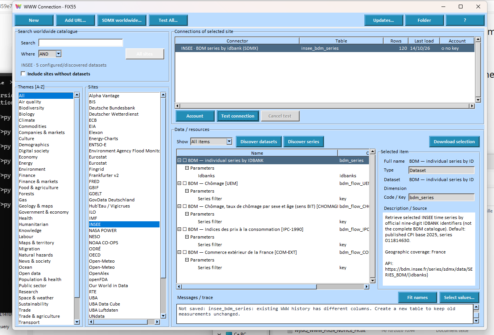
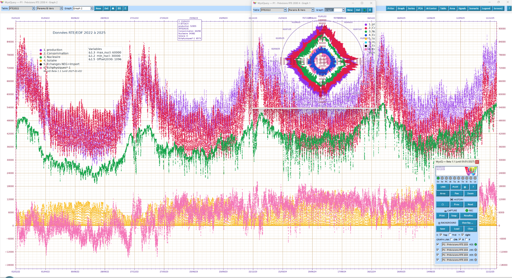
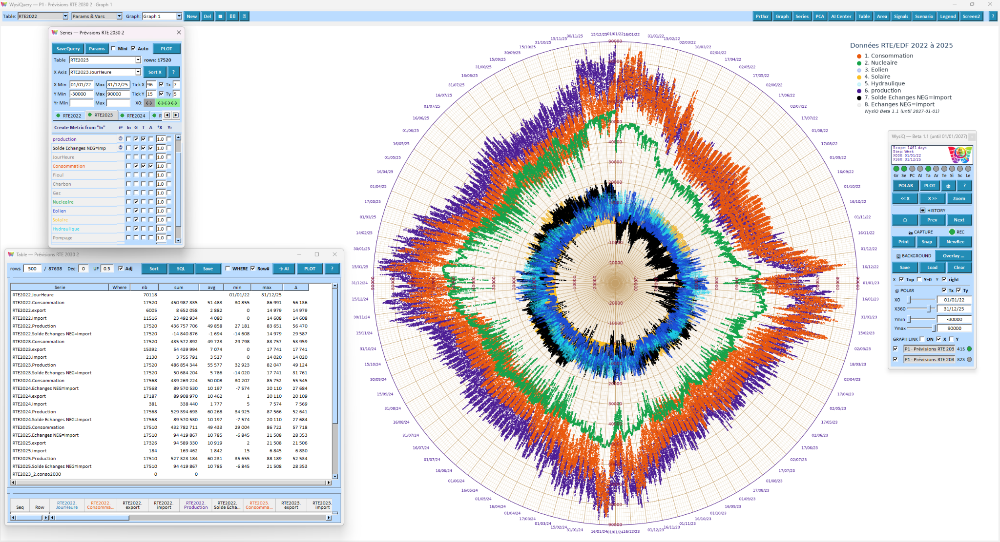

# WysiQ

## From Live Data to Analytical Intelligence

**White paper — October 2026 edition**

*Multi-domain WWW catalog · Static / Live tables · SQL Assistant · Multi-graph Query · Values / Percent · Rules & Vars · Scenarios*

**Understand the Past. Monitor the Present. Simulate the Future.**

An integrated, graph-centered environment connecting data access, preparation, observation, measurement and reasoning — without requiring analysts to write code.

**Development edition — October 18, 2026.** Some integrations and connectors still require validation against live services before commercial release.

---

# Executive summary

Useful data rarely lives in the same place as all the tools needed to understand it. It may be held in a file, an enterprise database, a statistical catalog or an Internet API. It must then be selected, combined, visualized, measured and explained. Conventional workflows scatter these operations across applications, exports and scripts, often losing the transformations and context that make findings reproducible.

**WysiQ proposes one continuous path: discover the data, make it usable locally, work directly inside living graphs, express business rules, challenge assumptions and reuse the results.** The platform is designed as an integrated environment rather than a stack of later additions. The graph is the enduring space for observation and interaction; SQL, DuckDB and tables retain their essential roles in preparation, control and preservation.

WysiQ includes a **multi-domain WWW connections catalog**, bringing Internet sources and their histories into a consistent workflow for preparation, Queries, Metrics and analysis. One Query gathers working tables and several named graph views: actual observations, averages and trends, analytical series and scenarios can be examined separately, each with its own **Values** or **Percent** display, without changing the underlying data.

WysiQ does not claim to own third-party data or to replace databases and established BI platforms. It connects their data to an independent, local and portable analytical workbench that can return tables, graphs and validated findings to the existing information environment.

## WysiQ capabilities at a glance

| Domain | Functions and workflows |
|---|---|
| Internet data | WWW Connections, worldwide catalog, configured connectors, dataset and series discovery and validation |
| Tables | Six modes — LS, LW, RS, RL, WS and WL — covering local snapshots, evolving file directories, remote databases and WWW sources |
| Preparation | SQL Assistant, cross-source preparation, materialization and table reduction before analysis |
| Query | Separate views for actual data, averages, Signals/PCA and scenarios in the same Query |
| Display | LINE / POLAR and per-graph Values / Percent readings, with preserved view context |
| Control | Graph Remote, independent windows, transparent overlays, side-by-side layouts and linked Pan / Zoom / POLAR rotation |
| Analytics | Metrics, Areas, Signals, Identify, statistical tests, PCA and correlations |
| Reasoning | Rules & Vars, dynamic thresholds, scenarios and simulation constraints |
| Reuse | History, captures, exports, contextual AI, sharing and hand-off to BI |

# 1. A different starting point for analysis

Relational systems made data reliable and queryable; BI tools made it possible to distribute insights at scale. Both remain indispensable. But when the question itself is still uncertain, a dashboard is not always enough. Analysts need to examine raw behavior, notice unexpected shapes, change boundaries, compare another period and only then decide which indicators matter.

WysiQ addresses that discovery phase. **Graph First** does not mean abandoning tables: tables remain central to storing, filtering and inspecting values; the graph becomes the main surface for human reasoning. Instead of illustrating a final answer, it helps people find the right question and test the explanation.

The analytical workflow combines **Data First, then Graph First**. WWW access shortens the distance between data published online and direct exploration. Independent researchers can investigate public statistics, while enterprise analysts can combine the same statistics with internal data. Both use the same visual engine.

## One connected workflow, not a collection of tools

| Stage | WysiQ capability | Preserved result |
|---|---|---|
| Access | Files, databases, WWW Connections | Identified source |
| Prepare | SQL Assistant, filters, JOIN / UNION, Shrink | Materialized working table |
| Explore | Query, LINE / POLAR, multiple graphs | Saved views and selections |
| Measure | Metrics, Areas, Signals, Tests, PCA | Reusable analytical objects |
| Reason | Rules & Vars, thresholds, scenarios | Explicit assumptions and constraints |
| Explain / share | AI Feeds, captures, HTML, exports | Findings with context |

# 2. WWW Connections: Internet data becomes part of WysiQ

With **WWW Connections**, analysts can start by discovering Internet datasets rather than first downloading files manually. They can search for a provider and dataset, inspect available resources, select published dimensions and series, test for dated numeric observations, and build a WysiQ table. Depending on the provider, the access method may rely on JSON, CSV, XML or SDMX APIs.

The scope is deliberately multi-domain: electricity systems and market prices, public statistics, economics, weather, environment, mobility, research and other open information. Connectors in the project address families of sources such as RTE, INSEE, Eurostat, the World Bank, Open-Meteo and European energy data. **A connector's presence in the catalog is not a blanket promise that every request will work.** URLs, historical periods, dimensions, quotas, authentication and reuse terms must be checked and validated for each service.

In SDMX, choosing one indicator does not necessarily select one time series. A series is identified by a combination of dimensions. WysiQ therefore makes the selected codes explicit, provides a **Test selection / Ready** check based on dated numeric values, and offers **Preview table** before Download. The distinction between a valid filter and available observations in a chosen period helps avoid overbroad requests and empty tables.

**Access does not imply ownership.** WysiQ provides a catalog, connection aggregation and access tools for third-party data. Original publishers retain the rights defined in their own licenses; caching, downstream reuse and commercial redistribution are subject to those terms, API keys and applicable restrictions.

# 3. One table model for local, remote and Live data

Once acquired, data should not become a different analytical object just because it came from a remote server, a file or the web. The Workspace distinguishes **six table modes**, but treats them as tables usable in Queries, graphs, Metrics and scientific analysis. A mode specifies how the table is supplied; it does not introduce a separate way of reasoning about the data.

| Code | Name | Source and behavior |
|---|---|---|
| **LS** | Local Static | Locally created, transformed or imported table, kept independently in the Workspace |
| **LW** | Local Watched | Local table fed by an evolving directory of files, including server-hosted folders; refreshable from those files |
| **RS** | Remote Static | Snapshot of a remote database table, materialized by an explicit load |
| **RL** | Remote Live | Incrementally updated from a remote database according to chosen time and key fields |
| **WS** | WWW Static | Internet data copied through a connector, with on-demand historical loading |
| **WL** | WWW Live | Internet table with scheduled acquisition and timestamped additions |

**LS and LW serve different purposes.** LS stores an independent working table in the Workspace. LW also keeps a local table, but its source is a changing collection of files in an accessible directory, including server-hosted folders. LW is not RL (remote database) or WL (Internet connector).

Local materialization uses DuckDB and Parquet files. An RS or WS table can be explored offline after loading. An RL or WL table retains local history after acquisition is stopped. Static / Live controls are designed to preserve table identity, provenance and existing records. Some mode transitions require compatible timestamps, including UTC for WWW Live history.

The table — not the graph — owns the data lifecycle: provider settings, refresh frequency, Start / Stop, resumption and acquisition state. **A graph subscribes to a table; it should not need an unrelated ingestion mechanism.** This separation lets Live tables behave like other Workspace tables, including when multiple Queries use them.

# 4. SQL Assistant: prepare only the data an investigation needs

Connection is just the first step. WysiQ combines a File Loader for common files with **SQL Assistant**, which can query databases and tables, select columns, filter, aggregate, join and materialize results. JOIN and UNION operations help combine heterogeneous systems, while reducing very large source tables avoids reloading irrelevant rows or fields.

Analysts can preserve a comprehensive source as the original record while creating a smaller, independent local working table for a specific question. The transformation is separate from visual presentation. Once the table exists, it can be reused, saved and shared with other Queries without rerunning an external script.

**A real WysiQ development example:** a WWW table based on the French eCO2mix dataset was used in SQL Assistant to create a lighter table, `RTE_2012_2025`. A Query originally built on the downloaded source was redirected to that new primary table. Once stale source references in the saved Query were corrected, opening the Query no longer requested the original WWW table, which held roughly twice as many rows. The resulting faster startup came from properly separating provenance, working data and actual Query dependencies — not from moving the business logic into a custom script.

# 5. Graph First: see behavior before reducing it

The **Data Oscilloscope** is a persistent analytical work surface. In LINE mode, time, distance or another ordered dimension is the X axis. Users can zoom, pan, compare and inspect observations in the working Table while keeping annotations and analyses attached to the view. In POLAR mode, X is projected onto a cycle, revealing repetition, seasonality and phase differences in a different visual language.

An extensive time span can be viewed as a whole and then explored down to a day or an individual observation. Fast drawing, selectively hidden elements, transparent views and independent palettes make dense exploration practical on large displays. The user decides what to inspect and when a full redraw is warranted.

**The key distinction is that the view never substitutes for the data.** Stored values keep their units and provenance. Zooming, panning, rotating and changing transparency affect a representation, not the observations in the table.

# 6. One Query, several graphs for distinct analytical views

A **WysiQuery** preserves the working tables, selected series, Metrics and settings of an investigation. It holds several named **Graph views**, each with its own series selection, legend, boundaries and representation. These views share one analytical context: there is no need to copy the underlying data or crowd every result into one plot.

Four complementary readings can coexist: **Graph 1** shows actual observations and raw series; **Graph 2** focuses on averages, smoothing and trends; **Graph 3** displays computed Signals or **PCA components converted into series**; and **Graph 4** explores scenarios and simulated trajectories. The analyst moves from facts to trends, detected structures and possible outcomes without mixing everything on one unreadable scale.

The Graph selector makes it possible to **switch views in one click** without rebuilding the investigation. Each view has its own **Values / Percent** choice and preserved framing. One Query can also combine several tables, X-aligned or arranged sequentially. Its effective main table is the table actually selected, not an obsolete original source left behind after SQL Assistant prepared a working copy.

For simultaneous comparison, Graph views can be **detached into independent windows**, **arranged side by side** or **overlaid with transparent backgrounds**. **Graph Link** can synchronize **Pan**, **Zoom** and **POLAR rotation**, while each window retains control of its own series and settings. Analysts can examine the same moment or cycle at several analytical levels without overloading a single visualization.

# 7. Values / Percent: compare shape without rewriting numbers

**Values** displays each series in its original units and magnitudes. **Percent** creates a shared visual scale: **each series is expressed as a percentage of its own maximum absolute value**. For a series y, the displayed point is `100 × y / max(|y|)` when that maximum is nonzero. Zero remains zero and negative values remain negative.

This makes shapes from different ranges easier to compare. Electricity generation, consumption or other metrics can be compared by trajectory without suggesting their absolute volumes are identical. **Here, 100% means that series' own absolute peak, not its percentage contribution to a total.** The distinction matters when interpreting or exporting the view.

Values / Percent is a **graph display choice**, not a destructive transformation of a table or Metric. Each graph view in a Query can use a different reading. The interface maintains appropriate axis contexts for each mode and graph type so that switching readings does not unnecessarily discard the boundaries users have carefully set.

# 8. Graph Remote, linked graphs and direct control

Graph Remote gathers functions needed while observing: LINE / POLAR, Plot, X movement, Zoom, Pan, history, capture, overlays and analytical palettes. Keyboard and mouse navigation allow large graph surfaces to be controlled without returning to a setup form for every action.

The **multiprocess Graph Hub** coordinates graphs belonging to different WysiQ processes. A shared Remote follows the active graph, and relevant commands can be propagated to linked views. Detached or overlaid graphs remain independent rather than becoming one drawing. Linked navigation helps analysts compare periods and series while preserving each window's purpose.

Display settings separately control **zoom step (%)**, **pan step (%)**, **arrow repetition (ms)** and **graph link delay (ms)**. Horizontal zoom preserves Y bounds and vertical zoom preserves X bounds. In POLAR, << X / X >> rotation and radial zoom are designed to respond to the first press, avoiding unnecessary full redraws. These are not cosmetic options: they give the analyst explicit control over precision and responsiveness.

# 9. From observation to measurement: Areas, Metrics, Signals, statistics, PCA, Identify

What makes exploration reusable is the ability to name and preserve its results. An **Area** defines an X/Y scope, the participating series and the measurements to calculate. Several Areas can be saved to compare periods; a post-it freezes a visible result, while a parameterized Area can be recalculated. A visually noticed pattern becomes measurable without losing its context.

A **Metric** is a calculated series whose recipe remains editable: sums, differences, weighted combinations, offsets, time shifts, residuals or business formulas. Metrics can use series from different tables while keeping qualified source keys and the parameters required to reproduce the calculation. Their outputs are genuine series available to Graph, Table, Areas and later analysis.

**Signals** characterizes motion within a series: variability, drift, spikes, changes in sign, oscillations, frequencies and localized events. **Statistical tests** quantify differences and dependencies with explicit assumptions and multiple-testing safeguards. **PCA** highlights shared structures; **Identify** investigates distributions and fitted models. Correlation and lag exploration can lead to a residual Metric that shows what a proposed relationship fails to explain.

The method remains scientific: correlation is not causation, a strong fit does not establish a physical law, and a simulation cannot validate its own assumptions. WysiQ aims to retain settings, populations, boundaries and results so interpretations can be challenged and checked.

# 10. Rules & Vars: business reasoning behind living graphs

Variables are not merely constants drawn as horizontal lines. In **Rules & Vars**, **Vars** describe capacities, assumptions, coefficients and control settings; **Rules** encode business constraints using those Vars and the observed series. A Rule can calculate a different minimum or maximum limit at every point in time. Graphical thresholds then express changing operating rules rather than arbitrary fixed alerts.

In an electricity system, demand cannot be met beyond **available generation plus imports actually obtainable**, themselves constrained by interconnector limits and what neighboring systems can supply. Conversely, surplus generation cannot always be absorbed: demand, permitted exports and available storage jointly set the limit. Periods approaching or exceeding those limits can be isolated by Areas and quantified by Metrics.

**The same rules support both historical analysis and hypothetical constraints.** Changing a Var does not rewrite the historical record. It changes the explicit calculation of a Rule or scenario. Analysts can compare what occurred with what alternative decisions might produce, subject to the assumptions of the model.

# 11. Scenarios: from what happened to what might happen

A scenario takes one or more series, applies a set of assumptions and preserves the hypothetical outcome separately from actual observations. In an electricity balance, replacing some nuclear output with solar cannot be judged solely by annual energy totals. The decisive questions may be hourly or sub-hourly: **when is supply insufficient, and when must otherwise available generation be curtailed?**

Rules & Vars can specify import, export and storage capacities or other operating bounds. Scenarios can then compare unmet demand, unused output and periods in which a constraint becomes binding. The approach extends to inventory, manufacturing capacity, logistics, water systems and any process governed by time-varying limits.

WysiQ distinguishes **observed values**, **simulation parameters** and **calculated scenario outcomes**. Scenarios are instruments for reasoning, whose usefulness depends on the completeness of available constraints and data; they are not independently certified forecasts. Some advanced Live orchestration and simulation workflows remain under validation with real applications.

# 12. Artificial intelligence follows the measured facts

AI can accelerate explanation, writing, hypothesis development and comparison of interpretations. It is most useful when the prompt is grounded in chosen series, Areas, Metrics, statistical results, tests, PCA findings, scenarios, captures and provenance. WysiQ builds that structured context through **AI Feeds** rather than indiscriminately sending entire raw datasets to a language model.

This approach supports both reasoning quality and data control. Mathematical measurements are computed by analytical engines; the language model helps interpret and formulate. Users retain responsibility for deciding what to send and for checking the response. Local models can be used when appropriate for their capabilities; cloud services are optional and require connectivity, permissions and suitable data-handling conditions.

AI is therefore not WysiQ's source of truth. It complements an investigation already made explicit through calculated objects and identified constraints. **Observe, measure, reason, then explain** is an order that helps avoid unsupported interpretation.

# 13. Integrated, local, portable and reusable

WysiQ is built on open-source components and local analytical storage. A Workspace brings together the definitions, tables, saved files, Queries and preferences needed to resume the work. Once materialized, data remains usable without keeping an Internet or database connection constantly open. Local analysis does not require a WysiQ cloud server or a permanent online account.

The Windows distribution aims at a **self-contained executable** without heavy installation, typically in the order of 150 MB depending on the build. Workspace data and working documents can travel beside the application. Sharing a Workspace allows investigations to be resumed provided required dependencies travel with it and source licenses are respected. Interface and help resources are organized in five languages: French, English, German, Spanish and Italian.

Outputs go beyond a screenshot: result tables, files, high-resolution plots, HTML, snapshots, histories and sharing mechanisms can transmit evidence to colleagues. WysiQ can also feed prepared tables and validated calculations back into BI systems. Exploration and governed publishing become complementary layers rather than competing destinations.

# 14. Three investigations that show the full workflow

## Energy: combine electricity, market prices and weather

The WWW catalog opens routes to electricity, weather and — depending on the publisher — price series. SQL Assistant turns large datasets into tables suited to the study period. Several graphs within one Query isolate generation, demand, renewables and exchanges. LINE shows chronology, POLAR exposes cycles and Percent emphasizes relative shapes. Areas and Metrics quantify events; Rules & Vars express capacities and scenario assumptions. None of those steps alters the original observations.

## Economics and territories: compare heterogeneous sources

A public statistic, demographic series, weather measurement and internal business indicator may belong to the same investigation despite distinct formats and sampling frequencies. WysiQ makes temporal alignment, time range and measurement units explicit before representing them together. Areas, tests and PCA help separate a visual coincidence from a relationship worthy of deeper investigation.

## Operations and enterprises: shorten the path from anomaly to decision

An analyst loads several production, sales or logistics sources, consolidates them with SQL Assistant and saves a Query. Named graphs hold parallel business perspectives: outcome, throughput, quality and cost. Signals describes shifts in behavior; dynamic rules express operational capacity. Calculated objects can feed a report or established dashboard without reconstructing the entire investigation.

# 15. What WysiQ is — and what it does not claim

WysiQ is an **integrated workbench for data access, observation and reasoning**, suitable for independent research and enterprise analysis preparation. Its distinctive proposition is not more charts. It is the ability to keep source data, measurements, business rules, scenarios and multiple graphical views together as a saved analytical environment.

This edition does not describe WysiQ as a commercially released product. Its WWW connectors form an extensible catalog whose availability depends on external services. Live handling, multi-graph workflows, AI integration and some simulation features still require ongoing provider-by-provider and use-case validation, including performance and edge cases. A successful prototype or automated test is not a substitute for a certified production rollout.

Analysts remain responsible for X-axis alignment, time zones, units, missing observations, duplicates, statistical quality and the meaning of results. Third-party data also requires checking licenses, quotas, API keys and redistribution conditions. WysiQ makes investigations more continuous and reproducible; it cannot remove the complexity of the systems being studied or replace professional judgment.

# Conclusion — the graph is no longer the final illustration

**WWW Connectors** provide access to multi-domain Internet datasets; **SQL Assistant** turns them into usable local working tables. **Multi-graph Queries** separate actual values, averages, analytical series and scenarios, then compare these views transparently or side by side with linked navigation. **Values / Percent** adds another reading without rewriting the data. **Areas**, **Metrics**, **Signals**, tests, **PCA** and **Identify** turn observation into measurement, while **Rules & Vars** link measurements to business constraints and simulation.

These capabilities are designed as one process: **access → prepare → observe → measure → reason → simulate → explain → share**. Relational systems retain their essential data role, BI platforms can publish validated indicators, and AI can assist explanation. Between them, WysiQ offers a durable place for users to frame questions, test evidence and explore the consequences of their decisions.

**WysiQ — Understand the Past. Monitor the Present. Simulate the Future.**

# Essential glossary

| Term | Meaning in WysiQ |
|---|---|
| WWW Connector | Definition used to access a published Internet dataset through an API or resource |
| LS / LW / RS / RL / WS / WL | Local static and watched-file tables, remote database static/live, and WWW static/live modes |
| Workspace | Local collection of tables, Queries, settings and working files |
| Query / WysiQuery | Saved investigation containing tables, series, graphs and analytical objects |
| Graph View | Named view within a Query, with its own plotted series and display settings |
| Values / Percent | Original values / each series displayed as a percentage of its own absolute peak |
| Graph Hub | Coordinates graphs and controls among WysiQ processes |
| Area | Measurement scope defined by boundaries and participating series |
| Metric | Calculated series with an explicit recipe and source references |
| Rules & Vars | Dynamic business rules and adjustable parameters |
| Scenario | Hypothetical trajectory kept separate from observed data |
| AI Feed | Structured analytical context deliberately submitted to an AI |

*Editorial note — This edition draws upon previous WysiQ white papers, product decisions taken in October 2026, and development sources through FIX71. Screenshots show an evolving development interface. Third-party API access and reuse rights remain subject to each publisher's terms.*
